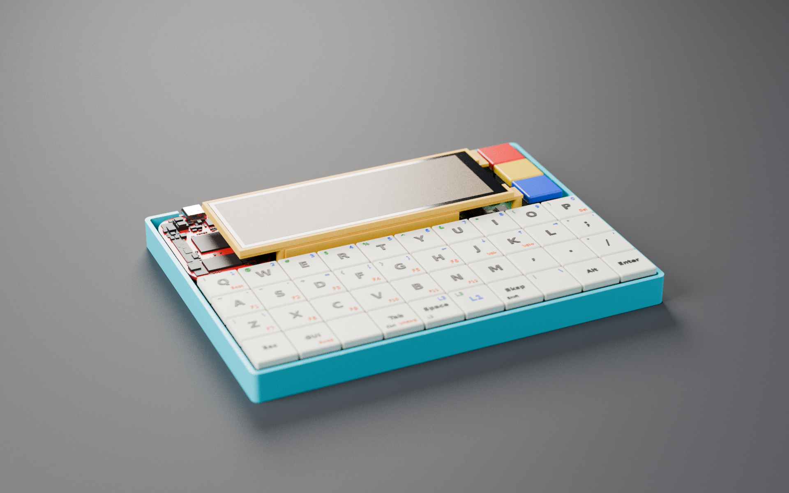
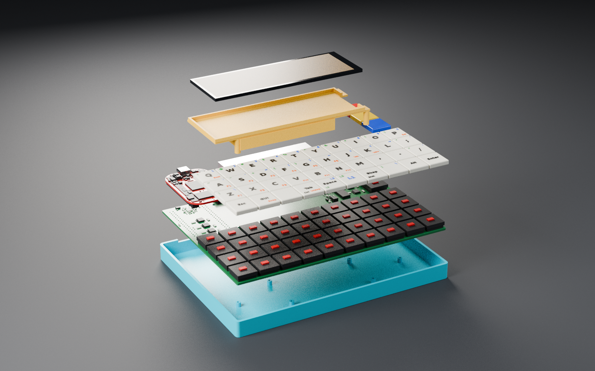

# Zine Machine

> **🚧 Work in progress — not ready for fab yet.**
> Nothing here has been built or tested on real hardware. The v3 main board is routed and passes DRC, but its fab
> outputs and the "verify before ordering" checks are still open. Don't order boards from these files yet.

A pocket Linux computer built around a 40% keyboard: the [bancouver40](https://github.com/ChrisChrisLoLo/bancouver40)
4×10 Choc keyboard, a [PocketBeagle 2 Industrial](https://www.beagleboard.org/boards/pocketbeagle-2-industrial)
and a 4.58″ 320×960 bar display, battery powered, in an open 3D-printed tray.

*Blender renders of the v3 design: the routed main board from KiCad, the printed tray and display chassis, and
keycaps carrying the stock bancouver40 layers. The interactive page (<https://elevenarms.github.io/zinemachine0/>)
still shows the earlier v2 layout.*

## What it is (v3)

| | |
|---|---|
| Computer | PocketBeagle 2 Industrial (TI AM6254, 1 GB DDR4, 64 GB eMMC, −40…85 °C), face-down on its low-profile 3.55 mm sockets, USB-C out through the rear wall |
| Keyboard | 40 Kailh Choc v1 keys (4×10 ortholinear, CFX caps) plus three red/yellow/blue **mode keys**; switches soldered, no hot-swap |
| Key scanning | the PocketBeagle's own Cortex-M4F reads every key directly through six chained 74HC165s on its MCU-domain pins: no matrix, no diodes, full rollover |
| Display | 4.58″ 320×960 IPS bar panel (ST7701S), RGB565 over the AM62's VOUT0 + 3-wire SPI init, TPS61165 backlight boost |
| USB | FE1.1s hub on the PocketBeagle's USB1, two rear USB-A ports (500 mA each, TPS2051B) |
| Power | 1S LiPo (about 9 × 40 × 70 mm, ~2.5–3 Ah) under the display; IP5306 charger/5 V boost with its own rear charging USB-C; chunky slide switch; charge, power and boot LEDs |
| Audio | ES8388 codec over I2S: headset jack (headphones + mic, TRRS) and a line-out jack |
| Main board | 170 × 126 mm, 4 layers, all assembled parts on the top side; routed, DRC clean |
| Enclosure | open printed tray (175.2 × 131.2 × 12.5 mm) the whole assembly sits in; a printed display chassis holds the panel and boxes and clamps the battery; about 21 mm tall overall |

Keycap legends: base layer in the centre, Layer 1 (hold **L1**: numbers, brackets, arrows) top right in blue,
Layer 2 (hold **Space**: shifted symbols) top left in green, Layer 3 (both: F-keys, volume, Del, Boot) bottom right
in orange, hold functions bottom left.

## Repository layout

| Path | Contents |
|---|---|
| `pcb/bancouver40_pb2/` | the main board, KiCad 10 project: [v3 spec](pcb/bancouver40_pb2/DESIGN_v3.md) (positions, pin map, blocks), schematic sheets, PCB, own footprints/symbols (`zm_v3.*`), fab file |
| `tools/zm_v3/` | scripts that generate the v3 schematic and board from `design.py` and reproduce the routing (`krt_route.sh`, `finish.sh`) |
| `mech/` | FreeCAD scripts and parts: `tray`, `display_chassis` (both with fab files), `pb2_envelope` (light PocketBeagle model), `zine_concept` (whole-device layout with legends and exploded view), `fitcheck_board` (board STEP vs. mechanics) |
| `mech/render/` | Blender render script and output (`blender -b -P mech/render/zine_render.py -- 128 hero exploded`) |
| `case/pocketbeagle2/models/industrial/` | PocketBeagle 2 Industrial references: Rev A schematic, dimension drawing, [header pinout CSV](case/pocketbeagle2/models/industrial/pb2_header_pinout.csv), SysConfig |
| `case/pocketbeagle2/` | the earlier v2 case (SolidCraft), kept for reference |
| `bom/`, `site/`, `tools/pocketbeagle2/` | v2 BOM, the interactive page, and the v2 generator scripts |
| everything else | the upstream bancouver40 repository, unchanged ([original README](README-bancouver40.md)) |

Large files that are rebuilt by scripts or downloaded (the 110 MB PocketBeagle STEP conversion, assembly STEP/GLB
outputs) are git-ignored; see `.gitignore`.

## Status / open items

- Main board: silkscreen cleanup, fab outputs and README (stage 4).
- Charger choice: plain IP5306 (charge LEDs work with the device off; used now) or IP5306-I2C (Linux reads charge state).
- Check the PJ-327A headset jack's pin assignment with a plug and a meter.
- The fab stocks only 75 of the GCT USB1046 USB-A ports.
- Power budget is tight: ~2.3 A worst case against the IP5306's 2.1–2.4 A.
- Choose the battery cell and the slide switch, and decide what the three mode keys do.
- Software: M4F key-scan firmware + RPMsg-to-uinput service, device-tree overlay for the panel, codec and hub.
- From v2, still open: the display FPC pinout/contact side and fold length against a real panel.

## Credits

- **bancouver40** — keyboard design, PCB, case and firmware by **ChrisChrisLoLo (sporewoh)**:
  <https://github.com/ChrisChrisLoLo/bancouver40>, GPL-3.0. This project is a fork of it and everything in
  `pcb/bancouver40_pb2` starts from that board. The original README is kept as [README-bancouver40.md](README-bancouver40.md).
- **PocketBeagle 2 / PocketBeagle 2 Industrial** — hardware, schematic, drawings and 3D model by **BeagleBoard.org**. The STEP model
  (`case/pocketbeagle2/models/pocketbeagle2_v03_21_EVT.stp`, from <https://openbeagle.org/pocketbeagle/pocketbeagle-2>)
  is © BeagleBoard.org Foundation, [CC BY-SA 4.0](https://creativecommons.org/licenses/by-sa/4.0/); its web conversion is shared under the same licence.
  Pin functions come from the [PocketBeagle 2 documentation](https://docs.beagleboard.org/boards/pocketbeagle-2/).
- **KiCad** and the **KiCad libraries** — footprints and 3D component models (CC BY-SA 4.0 with the KiCad library exception), <https://www.kicad.org/>.
- **SolidCraft** (tangency-labs) — the case was modelled through SolidCraft's MCP server, <https://solidcraft.io/>.
- **Freerouting** — autorouting of the v2 display bus, <https://github.com/freerouting/freerouting> (not bundled).
- **KiCadRoutingTools** — routing of the v3 main board (built from source, not bundled).
- **FreeCAD** — the v3 tray, display chassis and fit checks; **Blender** — the renders.
- **three.js** (MIT) for the 3D page; **JetBrains Mono** and **Space Grotesk** (SIL OFL) via Google Fonts.
- **QMK** / **Vial** — keyboard firmware (GPL), as shipped by the upstream repo.
- Reference documents (linked, not redistributed): Maxen MX-046HS40FS-N01 / BuyDisplay ER-TFT4.58-1 panel drawing,
  Sitronix ST7701S and TI TPS61165 datasheets, Amphenol F32Q/F32R drawings.
- Design work assisted by Claude Code (Anthropic).

## License

GPL-3.0, inherited from bancouver40 (see [LICENSE](LICENSE)). The PocketBeagle 2 model and its derivatives are
CC BY-SA 4.0 (see [case/pocketbeagle2/models/README.md](case/pocketbeagle2/models/README.md)).
