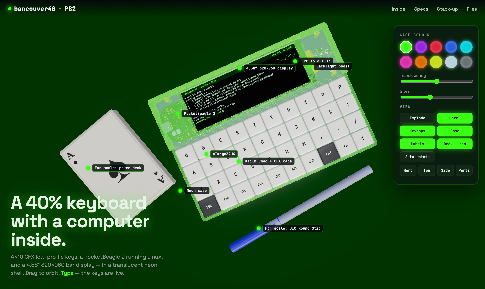

# Zine Machine v0

> **🚧 Work in progress — stay tuned — not at all ready for fab :p**
> Nothing here has been built or tested on real hardware yet. Don't order boards from these files.

A 40% keyboard with a Linux computer inside: the [bancouver40](https://github.com/ChrisChrisLoLo/bancouver40)
4×10 CFX low-profile keyboard, extended with a [PocketBeagle 2](https://www.beagleboard.org/boards/pocketbeagle-2)
and a 4.58″ 320×960 bar display, in a translucent printed case.

**Interactive 3D page:** <https://elevenarms.github.io/zinemachine0/>

## What it is

| | |
|---|---|
| Keyboard | bancouver40: 40 × Kailh Choc v1, CFX 16.5 mm caps, ATmega32U4 running QMK/Vial (unchanged) |
| Computer | PocketBeagle 2 (TI AM6254, 512 MB) on its own 2×18 sockets; it is the USB host for the keyboard |
| Display | 4.58″ 320×960 IPS bar panel (ST7701S), RGB565 over the AM62's VOUT0 + 3-wire SPI init, TPS61165 backlight boost |
| Enclosure | 175.2 × 121.2 mm; 12.5 mm keyboard deck stepping up to a 22.6 mm display deck; translucent resin (or CNC, see notes) |

The keyboard's own USB-C is removed: the 32U4 plugs straight into the PocketBeagle's USB1 host port, so the
stock bancouver40 firmware works unchanged.

## Repository layout

| Path | Contents |
|---|---|
| `pcb/bancouver40_pb2/` | KiCad 10 project (schematic + PCB), Gerbers/BOM/placement in `fab/`, [design notes](pcb/bancouver40_pb2/README.md) incl. pin map and the "verify before ordering" list |
| `case/pocketbeagle2/` | SolidCraft design (`bancouver40_pb2.solidcraft`), STL/STEP print files, renders, [dimensioned drawings PDF](case/pocketbeagle2/drawings/bancouver40_pb2_drawings.pdf) |
| `bom/` | [BOM with order links](bom/BOM.md), JLCPCB assembly BOM + CPL |
| `site/` | the interactive three.js page |
| `tools/pocketbeagle2/` | scripts that regenerate everything from the untouched upstream bancouver40 files |
| `pcb/bancouver40_pb2/v1_2in_lcd/`, `case/pocketbeagle2/v1_2in_lcd/` | the earlier 2″ SPI-LCD variant |
| everything else | the upstream bancouver40 repository, unchanged ([original README](README-bancouver40.md)) |

## Status / open items

See the design notes for detail. Before anything is fabricated:
- confirm the display's FPC pinout and contact side against the panel actually ordered;
- confirm the FPC fold length with a real panel;
- measure that PocketBeagle 2 P1.24 (VOUT) is 5 V;
- write the device-tree overlay and ST7701S init for the display;
- get real quotes (rough cost estimate: ~$275–300 for one unit, ~$150/unit for ten).

## Credits

- **bancouver40** — keyboard design, PCB, case and firmware by **ChrisChrisLoLo (sporewoh)**:
  <https://github.com/ChrisChrisLoLo/bancouver40>, GPL-3.0. This project is a fork of it and everything in
  `pcb/bancouver40_pb2` starts from that board. The original README is kept as [README-bancouver40.md](README-bancouver40.md).
- **PocketBeagle 2** — hardware and 3D model by **BeagleBoard.org**. The STEP model
  (`case/pocketbeagle2/models/pocketbeagle2_v03_21_EVT.stp`, from <https://openbeagle.org/pocketbeagle/pocketbeagle-2>)
  is © BeagleBoard.org Foundation, [CC BY-SA 4.0](https://creativecommons.org/licenses/by-sa/4.0/); its web conversion is shared under the same licence.
  Pin functions come from the [PocketBeagle 2 documentation](https://docs.beagleboard.org/boards/pocketbeagle-2/).
- **KiCad** and the **KiCad libraries** — footprints and 3D component models (CC BY-SA 4.0 with the KiCad library exception), <https://www.kicad.org/>.
- **SolidCraft** (tangency-labs) — the case was modelled through SolidCraft's MCP server, <https://solidcraft.io/>.
- **Freerouting** — autorouting of the display bus, <https://github.com/freerouting/freerouting> (not bundled).
- **three.js** (MIT) for the 3D page; **JetBrains Mono** and **Space Grotesk** (SIL OFL) via Google Fonts.
- **QMK** / **Vial** — keyboard firmware (GPL), as shipped by the upstream repo.
- Reference documents (linked, not redistributed): Maxen MX-046HS40FS-N01 / BuyDisplay ER-TFT4.58-1 panel drawing,
  Sitronix ST7701S and TI TPS61165 datasheets, Amphenol F32Q/F32R drawings.
- Design work assisted by Claude Code (Anthropic).

## License

GPL-3.0, inherited from bancouver40 (see [LICENSE](LICENSE)). The PocketBeagle 2 model and its derivatives are
CC BY-SA 4.0 (see [case/pocketbeagle2/models/README.md](case/pocketbeagle2/models/README.md)).
