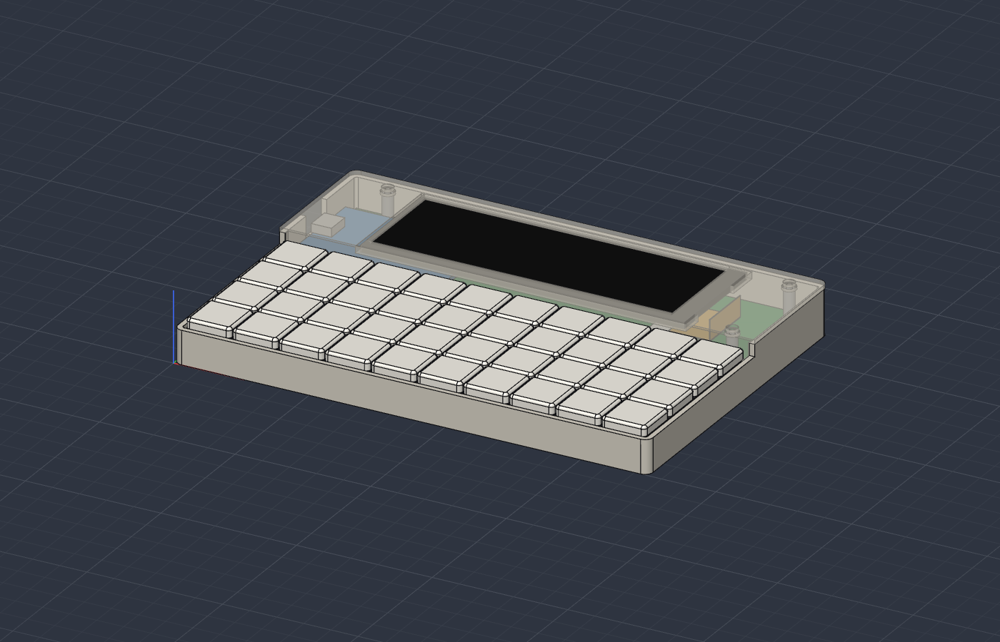
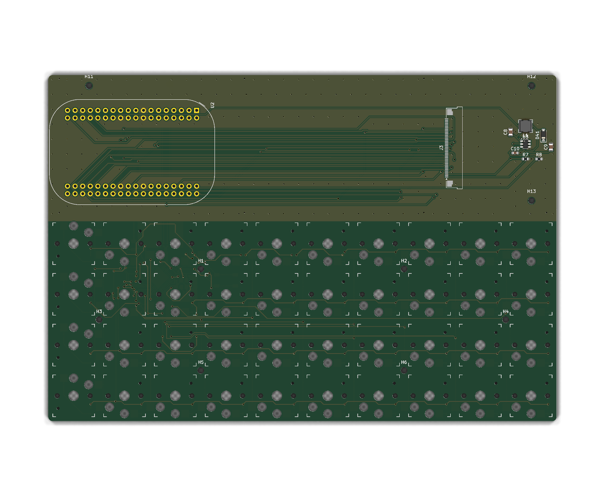

# Zine Machine v0 — PCB notes

> **Work in progress — not ready for fab.**

bancouver40 + PocketBeagle 2 + 4.58" 320x960 bar display

A variant of the bancouver40 with the board and case extended 48 mm north to carry a
[PocketBeagle 2](https://docs.beagleboard.org/boards/pocketbeagle-2/) and a 4.58" 320x960 IPS bar TFT
(ST7701S; e.g. [Maxen MX-046HS40FS-N01](https://maxen-lcddisplay.com/product/4-6-inch-bar-type-tft-display/),
BuyDisplay ER-TFT4.58-1 / Tailor Pixels TTG046XVS-01 — same 118.8 x 41.57 x 2.5 mm outline).
The keyboard matrix and ATmega32U4 are unchanged; the 32U4 is a USB keyboard wired into the
PocketBeagle's second USB port, so the stock QMK/Vial firmware works as-is.




The first version (2" Waveshare SPI LCD) is kept in `v1_2in_lcd/` and `case/pocketbeagle2/v1_2in_lcd/`.

## What changed on the PCB

| | |
|---|---|
| Outline | 170 x 116 mm (was 170 x 68), USB tab removed |
| Removed | J1 USB-C receptacle, R2/R3 (CC 5k1) |
| U2 | PocketBeagle 2 on the PocketBeagle header grid (`Module:BeagleBoard_PocketBeagle`), USB-C toward the left edge |
| J3 | 40-pin 0.5 mm FPC connector, Amphenol F32Q-1A7H1-11040 (top contact); F32R (bottom contact) has the identical land pattern |
| U3 + L1, D41, C8-C10, R7, R8 | TPS61165 white-LED boost for the backlight (2 x 4 LEDs, 11.2-13.2 V), 0.2 V / 5.1 Ω ≈ 39 mA, PWM dimming |
| H11-H13 | M2x15 standoffs that clamp the PCB to the case and hold the bezel |

Routing: the USB/VBUS links and the J1-removal repairs are hand-placed (`pcb_route.py`); the panel
bus and backlight are autorouted with Freerouting 2.5 restricted to the new nets (the keyboard's
copper is exported as fixed and never re-imported), then both layers are poured with GND and stitched.

### Display interface

The AM6254's DSS drives the panel as parallel RGB565 (DPI) on VOUT0; the ST7701S is initialised over
3-wire SPI. With the panel in 18-bit mode (MDT=1) DB17..12 = R5..R0, DB11..6 = G5..G0, DB5..0 = B5..B0:

| Panel (J3 pin) | PocketBeagle 2 | | Panel (J3 pin) | PocketBeagle 2 |
|---|---|---|---|---|
| DB17-DB13 (33-29) | VOUT0_D15..D11 = P2.34, P1.31, P2.30, P2.32, P1.33 | | PCLK (12) | P2.17 |
| DB12, DB0 (28, 16) | GND (R/B LSBs) | | DE (13) | P1.29 |
| DB11-DB6 (27-22) | VOUT0_D10..D5 = P1.36, P2.35, P2.18, P2.33, P2.24, P1.20 | | VSYNC / HSYNC (14 / 15) | P2.22 / P2.28 |
| DB5-DB1 (21-17) | VOUT0_D4..D0 = P2.20, P2.08, P2.06, P2.04, P2.02 | | SDA / SCK / CS (9 / 10 / 11) | P2.25 / P2.29 / P2.31 (SPI0) |
| VCI (5) | +3V3 (P2.23) | | RESET (6) | P2.10 (GPIO0_91) |
| LEDA / LEDK (1 / 2-3) | boost output / current sense | | Backlight PWM | P2.01 (ECAP2 APWM, mode 2) |

Pin functions verified against the PocketBeagle 2 pinmux tables
(docs.beagleboard.org/boards/pocketbeagle-2/04-expansion.html). **VOUT0_D10 and D11 share their header
pins with I2C1 (P1.36/P1.33 have a second ball each): leave the I2C1 balls unmuxed.** The panel's touch
pins (35-39) are left unconnected.

USB and power are as before: D-/D+ to P1.09/P1.11 (USB1 host), P1.24 VOUT -> F1 -> the keyboard's +5V
(also feeds the backlight boost), P1.05 USB1_VBUS left open.

Checks (KiCad 10.0.7 `kicad-cli`): 0 unconnected items; ERC and schematic parity show only what the
original project already has (KiCad 6 -> 10 auto-net naming, R4/R5 value fields, C3 thermal, U1 PC6).
Minimum track width is 0.12 mm (Freerouting necks to 0.187 mm, once 0.125 mm, at the 0.5 mm-pitch pads).

## Stack-up (case coordinates, z from the case bottom)

| z (mm) | |
|---|---|
| 0-1 | case floor |
| 4.5-6.1 | keyboard PCB on the original bosses + 3 through-bosses |
| 6.1-~8 | J3 connector; the panel FPC returns under the panel at ~7.4 |
| 6.1-12 | Choc v1 switches; CFX keycaps 12-15.6 |
| 6.1-14.6 | PocketBeagle 2's own 2x18 female sockets (8.5 mm) on a 2x18 male header inserted from under the PCB |
| 14.6-16.1 | PocketBeagle 2 board; tallest part under the panel 17.2, USB-C 15.1-19.3 (official BeagleBoard STEP) |
| 18.6-21.1 | bar panel, glued to the bezel's underside inside a locating frame |
| 21.1-22.6 | bezel, sitting on 3 x M2x15 standoffs (keyboard walls stay at 12.5) |

## Before ordering — verify these

1. **FPC contact side.** The panel drawing shows the stiffener on the front of the unfolded tail, so after
   the 180° fold under the panel the contacts face up -> top-contact F32Q. If your panel's contacts are on
   the other side, fit the F32R (same footprint).
2. **FPC fold length.** The 30 mm tail is budgeted as 1 mm straight + ~19 mm fold (r ≈ 6.1) + ~10 mm
   return into J3 (cable end at x ≈ 209.8 KiCad). Lay a real panel on a printout before committing.
3. **PocketBeagle mounting.** It plugs in on its factory sockets: fit a 2x18 male header from *under* the
   keyboard PCB (plastic below, pins up), trimmed to < 3 mm below the PCB (floor clearance). The design
   was checked against BeagleBoard's `pocketbeagle2_v03_21_EVT.stp` (an EVT revision).
4. **P1.24 VOUT is 5 V on PocketBeagle 2** (classic: `VOUT-5V`; PB2 docs just say `VOUT`). Measure it.
5. **PocketBeagle 2 USB-C position** (case opening 14 mm wide, centred on the short edge) and the
   microSD — it is under the panel now, so flash the card before assembly.
6. **Software:** a device-tree overlay for the DSS (RGB565, PCLK on P2.17, panel timings) plus the
   ST7701S init sequence (the vendor sends one; Linux has `panel-sitronix-st7701`).

## Regenerate

```sh
tools/pocketbeagle2/build_pcb.sh pcb/bancouver40_cfx/bancouver40_cfx.kicad_pcb pcb/bancouver40_pb2/bancouver40_pb2.kicad_pcb
python3 tools/pocketbeagle2/sch_update.py pcb/bancouver40_cfx/bancouver40_cfx.kicad_sch pcb/bancouver40_pb2/bancouver40_pb2.kicad_sch
python3 tools/pocketbeagle2/case_v2.py case/pocketbeagle2      # SolidCraft command scripts
```

Needs KiCad 10 (`~/Applications/KiCad`), Java >= 25 (`brew install openjdk`) and
`~/.local/share/freerouting/freerouting-2.5.0.jar`. Freerouting is not deterministic: the script retries
until a run finishes fully routed, so each rebuild gives slightly different (equally valid) copper.

The interactive site is `site/` (serve the repo root, open `/site/`). The case is `case/pocketbeagle2/bancouver40_pb2.solidcraft`; `stage1..5*.json` built it through the
SolidCraft MCP server (`tools/pocketbeagle2/sc.py`). `REF_*` bodies (PCB, PocketBeagle, panel, FPC,
connector, standoffs, 40 Choc switches and CFX keycaps) are fit-check placeholders, left out of the
STL/STEP print files.
